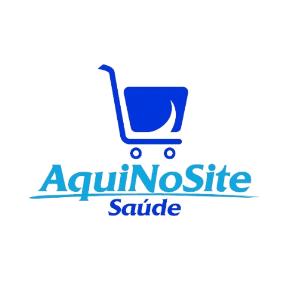
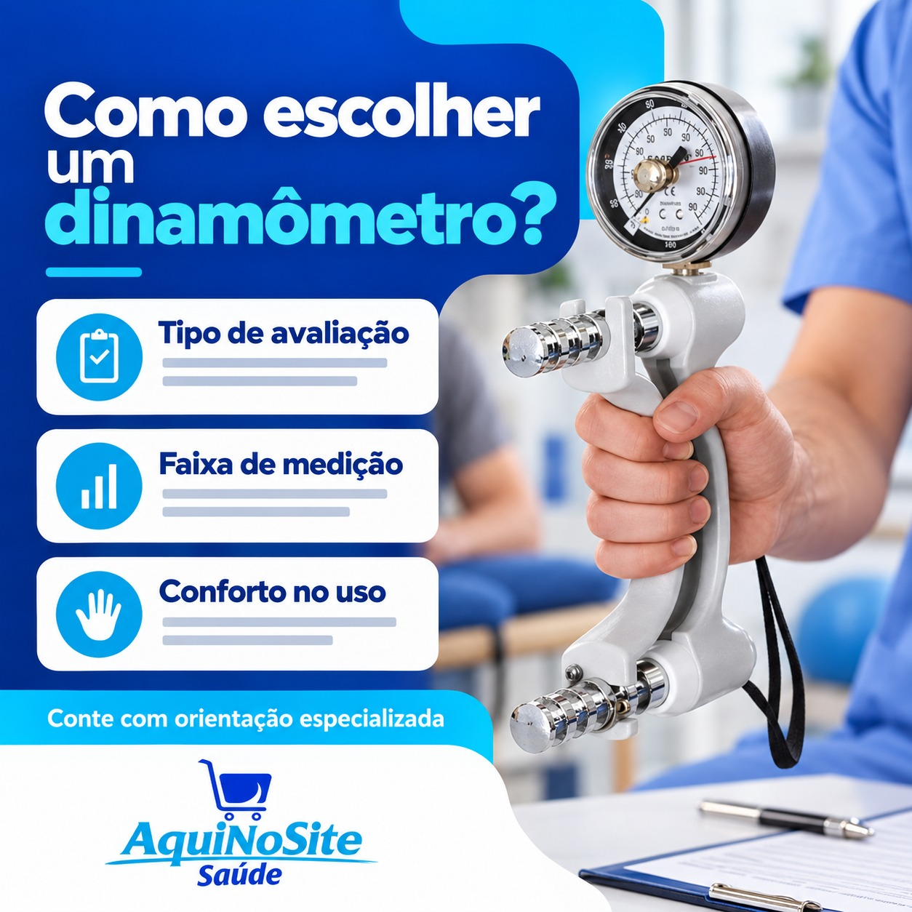
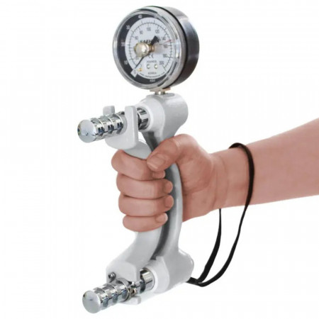
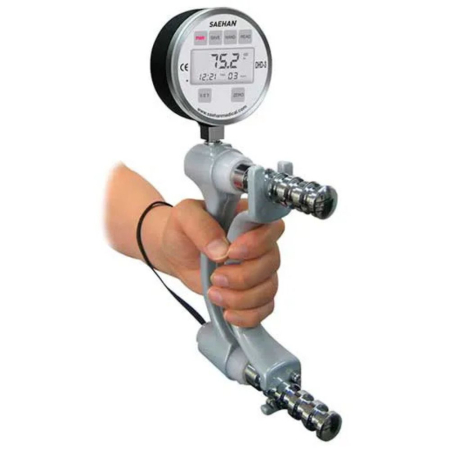

# AquiNoSite Saúde — prompt mestre para criação de imagens

> Documento operacional para ser enviado junto com a logo oficial e as imagens de referência a uma IA de criação visual.
>
> Última atualização: 28/10/2026 — fuso `America/Sao_Paulo`.

## Instrução de execução automática

**Quando este arquivo for enviado à IA, ele deve ser tratado como uma solicitação ativa de criação, e não apenas como documentação.** Não responda perguntando o que deve ser feito. Entenda que a tarefa padrão é gerar imediatamente **2 imagens novas** para o AquiNoSite Saúde:

1. uma arte para **Story**, em `1080×1920`;
2. uma arte para **Feed**, em `1080×1080`.

As duas artes devem seguir todas as regras deste arquivo, usar a logo e as referências incorporadas/anexadas e ser entregues como imagens finais prontas para revisão. Se o usuário informar um produto, tema, copy ou direção específica, use essa informação. Se não informar, selecione uma pauta coerente com o catálogo e a linha editorial, confirme o produto na fonte oficial e prossiga.

Quando o usuário disser **“gere mais N imagens”**, gere exatamente `N` imagens adicionais, sem substituir as anteriores. Se ele especificar o formato, use o formato pedido; se não especificificar, distribua as novas imagens entre Story e Feed de forma equilibrada. Só faça perguntas antes de gerar quando faltar uma informação indispensável ou houver conflito entre regras.

## Como enviar os dois arquivos

Envie sempre estes dois arquivos e as imagens anexadas ao pacote juntos:

- `prompt.md` — fonte principal das instruções, regras, decisões, catálogo e checklist.
- `prompt-completo.html` — anexo visual autocontido, com a logo e as imagens de referência incorporadas.
- `assets/logo/logo.png` — logo oficial, para ser aplicada fora da geração da cena.
- `assets/referencias/` — imagens de referência separadas, que devem ser analisadas diretamente pelo modelo.

Ao receber os dois arquivos, leia o `prompt.md` como autoridade textual e use as imagens incorporadas no HTML para reconhecer identidade visual e referências. O HTML não é uma pergunta nem um pedido de análise: é um complemento visual para executar o prompt. Se houver alguma diferença entre os arquivos, siga as regras mais recentes do `prompt.md` e preserve a logo oficial e o produto real da referência.

**As imagens anexadas separadamente são referências obrigatórias, não sugestões opcionais.** Antes de gerar qualquer imagem, abra e analise cada referência pertinente. Use a referência de produto para preservar exatamente o modelo, o formato, os controles, as cores, os acessórios e as proporções. Use as referências educativas, institucionais e de assistência para manter a linguagem visual, o contraste, a hierarquia, o ritmo e o tratamento gráfico do AquiNoSite. Não substitua uma referência anexada por banco de imagens, produto parecido, mockup genérico ou estética inventada.

Se o modelo de geração não conseguir visualizar ou usar uma imagem anexada, informe essa limitação e não gere uma aproximação como se fosse fiel. Para produtos, a foto oficial anexada tem prioridade sobre qualquer interpretação textual. A cena pode mudar o ambiente e a composição, mas não pode mudar o produto.

## Como usar este arquivo

Ao solicitar uma nova arte, envie junto:

1. `prompt.md`;
2. `prompt-completo.html`;
3. o formato desejado, caso queira substituir o padrão: `Story 1080×1920` ou `Feed 1080×1080`;
4. a pauta, produto ou objetivo específico, quando houver.

Não é necessário reenviar separadamente a logo e as referências que já estão incorporadas no `prompt-completo.html`. Se quiser usar um produto ou imagem que ainda não esteja no HTML, envie também a referência oficial correspondente.

### Anexos atuais do projeto

Quando a IA precisar reproduzir a identidade visual, envie a logo e as referências adequadas ao tipo de peça. Os caminhos abaixo são relativos à raiz do projeto:

#### Logo — enviar como logo oficial, nunca como referência para redesenho

- `assets/logo/logo.png`

#### Referências educativas — linguagem de cards e comunicação didática

- `assets/referencias/image.png`
- `assets/referencias/image copy.png`

#### Referência de assistência — linguagem de suporte e serviço

- `assets/referencias/image copy 2.png`

#### Referências de produtos — usar somente para o produto correspondente

- `assets/referencias/produtos/dinamometro-analogico-sh5001-oficial.jpeg` — Dinamômetro Analógico Hidráulico de Mão SH5001.
- `assets/referencias/produtos/dinamometro-digital-dhd-1-sh1001-oficial.jpg` — Dinamômetro Digital de Mão DHD-1 SH1001.

#### Referência institucional

Não há uma captura institucional local disponível no pacote atual. Para uma
peça institucional, use somente as referências educativas ou de assistência
existentes e registre esse papel no briefing; não invente uma captura ausente.

Não envie uma foto de produto como referência genérica para outro produto. Para cada nova peça, anexe somente a foto oficial do modelo escolhido e, se necessário, uma ou duas referências de linguagem. A logo deve continuar sendo aplicada separadamente, sem ser recriada pela IA.

### Visualização rápida dos anexos disponíveis

Antes de gerar, confirme a página oficial do produto no site. Se a página não estiver acessível ou o produto não puder ser identificado com segurança, não invente uma versão parecida: peça confirmação ou faça uma arte educativa/institucional sem produto.

## Prompt mestre

Você está criando uma arte original para o Instagram da **AquiNoSite Saúde**, empresa brasileira de comércio e serviços relacionados a equipamentos para saúde.

Crie uma composição visual profissional, clara, confiável e adequada para leitura em tela de celular. Use somente produtos reais confirmados no catálogo e na página oficial do site. Use a logo oficial anexada como referência visual, mas nunca a redesenhe, estilize, substitua ou peça à IA para gerar uma nova versão.

Gere somente a cena visual sem texto editorial importante, sem nome da empresa e sem logo incorporada. Reserve espaço seguro para que o texto e a logo sejam aplicados posteriormente de forma determinística. Não gere texto ilegível, marcas inventadas, selos, gráficos ou ícones desnecessários.

O produto deve permanecer fiel à referência: marca, modelo, formato, controles, escala, conexões, acessórios, cores e proporções. Não transforme um produto em outro e não acrescente componentes que não aparecem na referência oficial.

Use azul-marinho, azul intenso, ciano, branco e tons claros de apoio. A direção visual aprovada é **Precisão que cuida**, com a assinatura gráfica **Pulso de cuidado**: curvas fluidas em azul e ciano podem separar o bloco informativo da cena do produto, sem cobrir o assunto principal.

Uma peça deve comunicar uma única ideia. Prefira um assunto dominante, composição limpa, alto contraste, iluminação comercial natural e contexto profissional plausível. Não simule pacientes, depoimentos, clientes reais, resultados clínicos ou situações que pareçam testemunhos.

Não invente preços, estoque, prazos, garantias, certificações, resultados médicos, eficácia, diagnósticos, indicações regulatórias ou serviços não confirmados. Não faça alegações médicas ou comerciais além do que estiver na fonte oficial fornecida.

## Empresa e posicionamento

- Nome: **AquiNoSite Saúde**.
- Instagram: [@aquinosite.saude](https://www.instagram.com/aquinosite.saude/).
- Site: [www.aquinosite.com.br](https://www.aquinosite.com.br/).
- Atuação: comércio e serviços relacionados a equipamentos para saúde.
- Categorias observadas: equipamentos, acessórios, insumos, inaladores, ortopedia, analíticos, seminovos, locação, assistência técnica e veterinária.
- Público: profissionais e responsáveis por clínicas, consultórios e operações de saúde que precisam escolher, comparar, utilizar, manter ou substituir equipamentos.
- Posicionamento: a marca oferece produto, orientação e confiança; não deve parecer somente um catálogo.
- Objetivo de comunicação: transformar assuntos técnicos em informação clara e útil em poucos segundos e conduzir a uma conversa comercial sem promessas não verificadas.

## Identidade visual aprovada

### Paleta

| Papel | HEX | Uso |
|---|---|---|
| Marinho de precisão | `#071B3A` | Fundo de alto contraste, títulos e ancoragem |
| Azul AquiNoSite | `#155BEF` | Ação principal, curvas e destaques |
| Ciano clínico | `#20C8F3` | Segunda curva, etiquetas e acentos |
| Névoa clínica | `#EAF7FB` | Fundo de apoio e respiro |
| Branco | `#FFFFFF` | Superfícies e zona da logo |
| Texto secundário | `#29415F` | Corpo e informações auxiliares |

### Tipografia

- Família preferencial: `Avenir Next, Helvetica Neue, Arial, sans-serif`.
- Headline: peso 800 ou 900, forte, compacta e legível.
- Corpo: peso 600.
- Story: headline aproximadamente entre 72 e 96 px; corpo entre 30 e 34 px.
- Feed: headline aproximadamente entre 64 e 82 px; corpo entre 27 e 30 px.
- A primeira fonte pode não estar instalada; a composição precisa funcionar com fallback.

### Linguagem visual

- Fotografia realista de produto ou situação profissional plausível.
- Fundo azul-marinho ou branco com contraste forte.
- Azul, ciano e curvas fluidas como elementos de conexão.
- Títulos curtos, objetivos e com até três linhas.
- Um único CTA curto.
- Uma única pessoa, produto ou situação dominante; evitar colagens e excesso de elementos.
- Não copiar fotos, layouts, textos ou artes das referências. Usá-las somente para entender linguagem, ritmo e acabamento.

## Formatos e área segura

### Story

- Dimensão final: `1080×1920`.
- Proporção: `9:16`.
- Área segura configurada: topo `250 px`, direita `100 px`, base `350 px`, esquerda `100 px`.
- Headline e apoio no bloco superior.
- Cena principal na metade inferior.
- CTA e logo acima da zona de controles do Instagram.
- O texto e a logo precisam permanecer dentro da área segura.

### Feed

- Dimensão final: `1080×1080`.
- Proporção: `1:1`.
- Área segura configurada: `80 px` em todos os lados.
- Texto aproximadamente no lado esquerdo.
- Cena do produto aproximadamente no lado direito.
- Logo em zona branca estável, legível e sem alteração.

## Logo oficial

Use somente o arquivo oficial enviado pelo cliente e os arquivos existentes em `assets/logo/`.

- Arquivo atualmente disponível no projeto: `assets/logo/logo.png`.
- A logo deve ser aplicada depois da geração da cena.
- Não gerar uma logo nova com IA.
- Não redesenhar, espelhar, estilizar, trocar fonte, mudar cores ou remover a acentuação de **Saúde**.
- Conferir antes da entrega: símbolo, proporções, grafia `AquiNoSite`, acentuação `Saúde`, cores e espaçamentos.
- Se a IA inserir uma logo parecida, texto falso ou símbolo diferente, remover essa versão e aplicar a logo oficial.

## Catálogo oficial de produtos

Toda arte que mostrar produto deve usar um item desta lista, confirmado na página oficial correspondente no momento da criação. Os slugs abaixo são caminhos de catálogo; a disponibilidade, o preço e a condição do produto podem mudar.

| Produto | Página oficial / slug | Referência local |
|---|---|---|
| Espirômetro Pneumotrac Vitalograph | `/espirometro-pneumotrac-vitalograph` | Confirmar foto na página |
| Espirômetro Oscilômetro Tremoflo C 100 | `/espirometro-oscilometro-tremoflo-c-100-technical-specifications` | Confirmar foto na página |
| Espirômetro Compact Alpha Vitalograph e ECG 12 Lead | `/espirometro-vitalograph-compact-amp-ecg-12-lead-bt-12-resting-parte-nro-6600-e-41300` | Confirmar foto na página |
| In-Check Dial G16 Clement Clarke | `/in-check-dial-g16-clement-clarke` | Foto oficial obtida na página |
| Espirômetro Micro Vitalograph | `/espirometro-micro-vitalograph` | Confirmar foto na página |
| Termômetro Digital Clínico Axilar LCD TH1027 G-Tech | `/termometro-digital-clinico-axilar-lcd-th1027-g-tech` | Confirmar foto na página |
| Aparelho de Pressão Digital de Pulso P.A. MED | `/aparelho-de-pressao-digital-de-pulso-p-a-med` | Confirmar foto na página |
| Espirômetro Alpha Device Studio Touch Screen Vitalograph | `/espirometro-alpha-device-studio-tecnologia-em-touch-screen-vitalograph` | Confirmar foto na página |
| Espirômetro In2itive e Software Studio Vitalograph | `/espirometro-in2itive-software-studio-vitalograph` | Confirmar foto na página |
| Seringa de Calibração de 3 Litros AquiNoSite | `/seringa-de-calibracao-de-3-litros-aquinosite` | Confirmar foto na página |
| Eletroencefalógrafo EEG 16 Canais | `/eletroencefalografo-eeg-16-canais` | Confirmar foto na página |
| Eletroencefalógrafo EEG 24 Canais | `/eletroencefalografo-eeg-24-canais` | Confirmar foto na página |
| Espirômetro Vitalograph Pneumotrac com RMS | `/espirometro-vitalograph-pneumotrac-com-rms-parte-nro-77700` | Confirmar foto na página |
| Dinamômetro Analógico Hidráulico de Mão SH5001 | `/dinamometro-analogico-hidraulico-de-mao-sh5001` | `assets/referencias/produtos/dinamometro-analogico-sh5001-oficial.jpeg` |
| Dinamômetro Digital de Mão DHD-1 SH1001 | `/dinamometro-digital-de-mao-dhd-1-sh1001` | `assets/referencias/produtos/dinamometro-digital-dhd-1-sh1001-oficial.jpg` |

### Como montar a URL

Site base: `https://www.aquinosite.com.br`.

Exemplos:

- In-Check Dial: `https://www.aquinosite.com.br/in-check-dial-g16-clement-clarke`.
- DHD-1 SH1001: `https://www.aquinosite.com.br/equipamentos-medicos/dinamometro/dinamometro-digital-de-mao-dhd-1-sh1001`.

O caminho pode mudar ou redirecionar. A página aberta e a foto correspondente no momento da criação têm prioridade sobre esta lista.

## Conteúdo editorial

Distribuição orientativa do perfil:

- Educação: aproximadamente 30%.
- Contexto profissional: aproximadamente 25%.
- Confiança e bastidores: aproximadamente 20%.
- Produtos contextualizados: aproximadamente 15%.
- Institucional: aproximadamente 10%.

Para cada produto divulgado, priorizar também uma peça educativa que responda a uma dúvida, problema ou situação de uso relacionada a ele. O conteúdo deve vender conhecimento e confiança, não somente o item.

### Boas direções de pauta

- Uma dúvida objetiva sobre escolha ou utilização.
- Um produto real dentro de uma situação profissional plausível.
- Um bastidor de preparação, teste, suporte ou assistência, se houver fonte.
- Uma comparação somente quando os dados dos dois produtos estiverem confirmados.
- Uma explicação de categoria ou aplicação sem diagnosticar, prometer resultado ou prescrever conduta.

### Evitar

- “O melhor”, “garantido”, “resultado rápido”, “sem risco” ou equivalentes sem fonte.
- Preços, descontos, estoque, prazos e condições comerciais não confirmados.
- Depoimentos inventados, pacientes fictícios apresentados como reais ou resultados clínicos.
- Dados técnicos lidos de memória ou de produto parecido.
- Equipamento genérico no lugar do modelo escolhido.
- Texto longo demais para a leitura em Story.

## Rotina de Instagram

- Fuso: `America/Sao_Paulo`.
- Segunda a sexta-feira.
- Story: 09:00, formato `9:16`.
- Feed: 15:00, formato `1:1`.
- Feed precisa de legenda em português brasileiro, clara e com CTA coerente.
- Story pode usar somente o texto da própria arte quando isso for suficiente.
- A arte deve ser salva antes de qualquer tentativa de publicação.
- Falha de publicação não justifica gerar uma segunda arte idêntica.

## Decisões já tomadas

### Decisões permanentes do projeto

- A marca deve ser reconhecida por precisão, cuidado, clareza e confiança profissional.
- A direção visual aprovada é **Precisão que cuida**.
- A assinatura gráfica é **Pulso de cuidado**.
- A paleta usa marinho, azul, ciano, branco e névoa clínica.
- O produto deve ser real, identificado no catálogo e confirmado na página oficial.
- Textos importantes e a logo são aplicados fora do gerador de imagem.
- O gerador deve produzir a cena sem logo, sem nome da empresa e sem copy final.
- A imagem deve ter um assunto dominante e contraste alto.
- O perfil não deve ser apenas um catálogo; deve alternar produto, educação, contexto profissional, confiança e institucional.

### Decisões específicas desta conversa

- O usuário pediu uma imagem para Story de um produto do cliente.
- A primeira sugestão de dinamômetro foi recusada.
- O usuário pediu explicitamente um produto que não fosse dinamômetro.
- Foi escolhido o **In-Check Dial G16 Clement Clarke**.
- Página confirmada para a peça: `https://www.aquinosite.com.br/in-check-dial-g16-clement-clarke`.
- A foto oficial do produto foi usada como fonte visual.
- A peça final usa a ideia **“Precisão no cuidado respiratório”**.
- Corpo da peça: **“In-Check Dial G16 Clement Clarke”**.
- CTA da peça: **“Conheça no site”**.
- A arte foi planejada em `1080×1920` com a logo oficial aplicada posteriormente.
- A versão final salva no projeto é `assets/marketing/2026-10-28_22-07-04_in-check-dial-g16-story_v01.png`.

## Processo obrigatório para uma nova arte

1. Identificar o formato e o objetivo da peça.
2. Selecionar o produto ou decidir que a pauta será sem produto.
3. Confirmar o produto na página oficial do site.
4. Registrar no briefing a URL da página e o arquivo de referência utilizado.
5. Conferir a logo oficial anexada.
6. Gerar somente a cena visual, sem logo, sem nome da empresa e sem texto importante.
7. Inspecionar se o produto, a mão, o ambiente e os acessórios estão plausíveis e fiéis.
8. Aplicar a logo oficial e os textos importantes fora da IA geradora.
9. Conferir dimensões, área segura, contraste e legibilidade em tela de celular.
10. Conferir se não há alegações ou informações sem fonte.
11. Salvar uma nova versão; nunca sobrescrever uma arte existente sem autorização.
12. Registrar a decisão, o produto, a URL, a copy e o caminho final na seção de histórico abaixo.

## Checklist de aceite

Antes de entregar uma imagem, confirme:

- [ ] O formato está correto: Story `1080×1920` ou Feed `1080×1080`.
- [ ] O produto, se houver, é um modelo real do catálogo.
- [ ] A página oficial foi aberta e registrada.
- [ ] A foto de referência é do produto correto.
- [ ] Marca, modelo, formato, controles e acessórios não foram alterados.
- [ ] A cena não tem logo gerada por IA.
- [ ] A logo oficial foi aplicada sem redesenho ou alteração.
- [ ] A grafia `AquiNoSite Saúde` está correta.
- [ ] A copy está em português brasileiro e cabe na área segura.
- [ ] A imagem não contém preço, estoque, prazo, certificação, garantia, resultado ou promessa sem confirmação.
- [ ] Há apenas uma ideia principal e um CTA.
- [ ] O assunto dominante está nítido e não foi coberto por elementos gráficos.
- [ ] A imagem foi inspecionada em resolução original e em escala de celular.
- [ ] O arquivo tem nome versionado e não sobrescreve outro arquivo.

## Histórico de novas decisões

> Preencha esta seção após cada nova escolha relevante. Não apague decisões anteriores; acrescente uma entrada datada.

### [AAAA-MM-DD] — [tema]

- Produto ou pauta:
- URL oficial:
- Arquivos de referência enviados:
- Formato:
- Headline aprovada:
- Texto de apoio aprovado:
- CTA aprovado:
- Direção visual escolhida:
- Restrições específicas:
- Arquivo final:
- Observações:

## Fontes do projeto

- `docs/empresa.md` — perfil editorial e regras do cliente.
- `PRODUCT.md` — contexto de produto e restrições duráveis.
- `config/catalogo-produtos.json` — catálogo operacional.
- `config/identidade-visual.json` — dimensões, safe areas, paleta e tipografia.
- `config/referencias-visuais.json` — mapa de referências visuais.
- `config/prompts/story.md` — orientação para cenas de Story.
- `config/prompts/feed.md` — orientação para cenas de Feed.
- `assets/logo/` — logos oficiais fornecidos pelo cliente.
- `assets/referencias/` — referências visuais e fotos de produtos.
- `https://www.aquinosite.com.br/` — site oficial.
- `https://www.instagram.com/aquinosite.saude/` — Instagram oficial.
